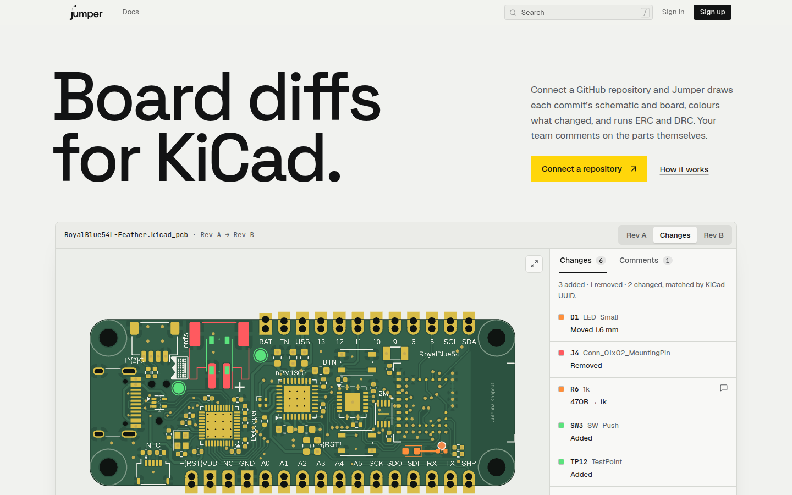
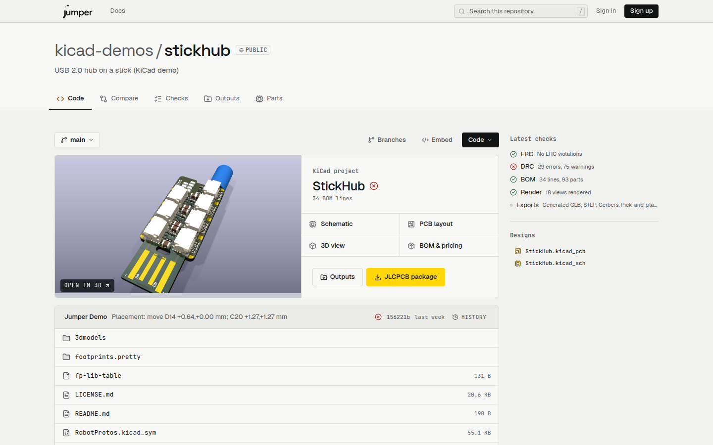
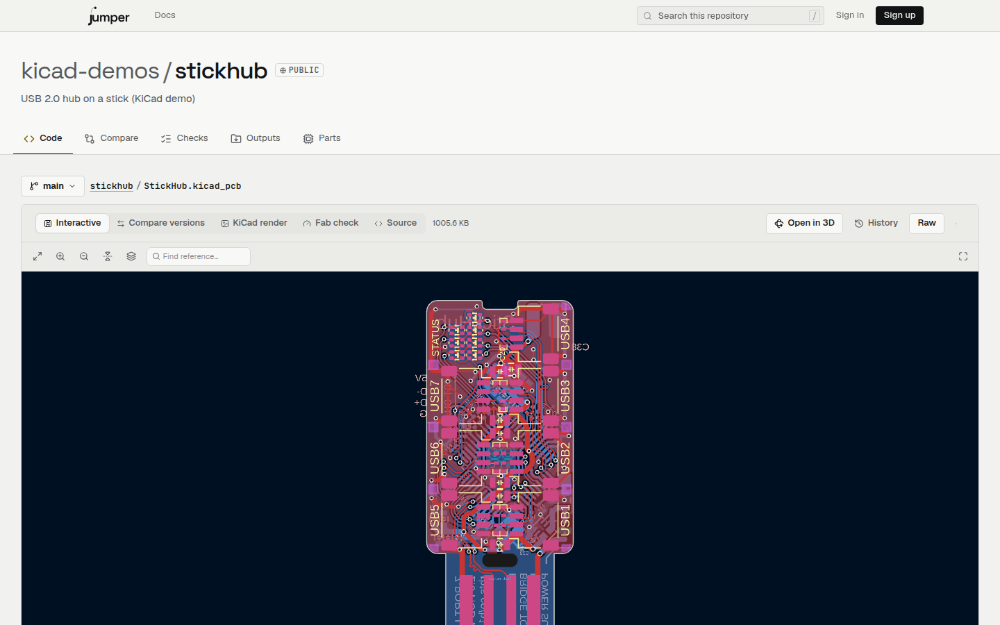
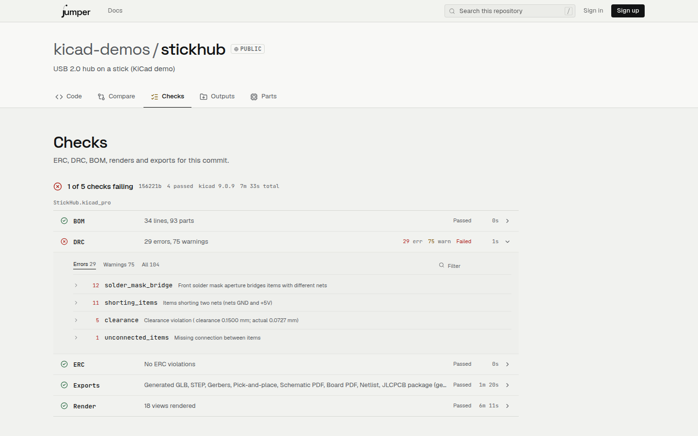
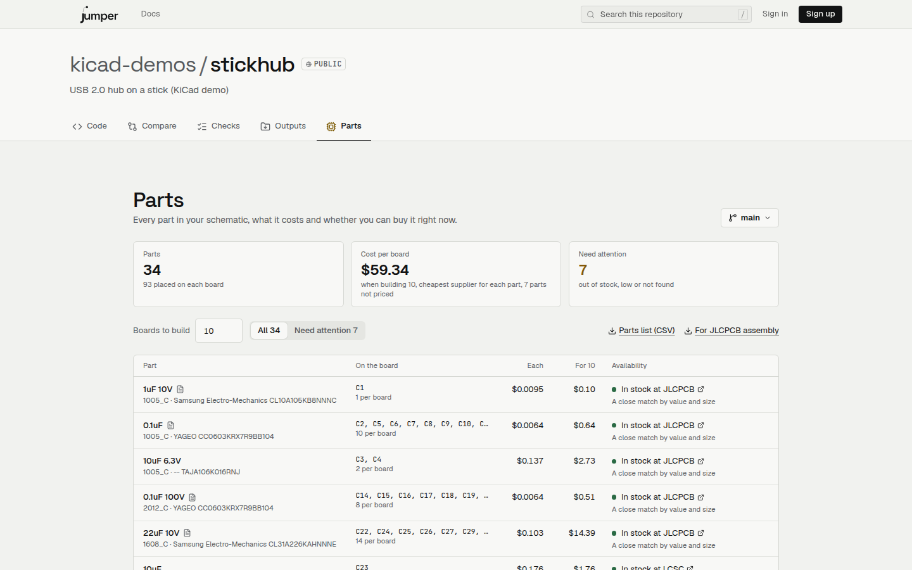

# Jumper

A self-hosted git server for KiCad projects.

Push a KiCad project and Jumper runs ERC and DRC, renders the schematic and board, builds a priced BOM and makes the fab files. You can also compare any two commits and see what changed on the board.

It's free and open source. You can run it on your own server with Docker.



## Features

- Visual diff between any two commits: parts, nets and tracks
- ERC and DRC on every push, using `kicad-cli`
- Schematic, PCB and 3D viewer in the browser
- BOM with live prices and stock from LCSC, JLCPCB, Mouser and DigiKey
- Gerbers, drill files, pick-and-place, STEP and a JLCPCB-ready zip
- Pull from GitHub or GitLab, or push over HTTPS and SSH
- KiCad plugin to commit and push from the PCB editor
- Organizations, roles, share links, webhooks and Git LFS

## Screenshots

| Repository | PCB viewer |
| --- | --- |
|  |  |

| Checks | Parts and prices |
| --- | --- |
|  |  |

## Run it with Docker

```sh
git clone https://github.com/baralchirag/gitcad.git jumper
cd jumper
cp .env.example .env
# set POSTGRES_PASSWORD, MINIO_ROOT_USER and MINIO_ROOT_PASSWORD in .env
docker compose -f docker/docker-compose.yml --env-file .env up -d --build
```

Open the site, sign up, then make yourself admin:

```sh
docker compose -f docker/docker-compose.yml exec api node dist/admin.js grant <your-username>
```

More details are in the in-app docs at `/docs/self-hosting`.

## Run it for development

You need Node 22, pnpm, PostgreSQL and Redis. Install KiCad 8 or 9 if you want the checks to run.

```sh
pnpm install
cp .env.example .env
pnpm services     # starts PostgreSQL and Redis
pnpm dev          # web on :5173, api on :3000
```

To change the Rust parser, you also need Rust and `wasm-pack`. Then run `pnpm wasm`.

## Project layout

```
apps/web          React frontend (Vite, TanStack Router, Tailwind)
apps/api          Fastify API and git server (HTTP and SSH)
apps/worker       Job runner that calls kicad-cli
packages/kicad-core  KiCad file parser and diff, in Rust (built to WASM)
packages/viewer   Schematic, PCB and 3D viewer
packages/db       Database schema and migrations (Drizzle, PostgreSQL)
packages/shared   Shared types and config
packages/ui       UI components
plugins/kicad     KiCad plugin (Python)
docker            Dockerfiles and Compose setup
```

## Tests

```sh
pnpm test
```

## License

AGPL-3.0
